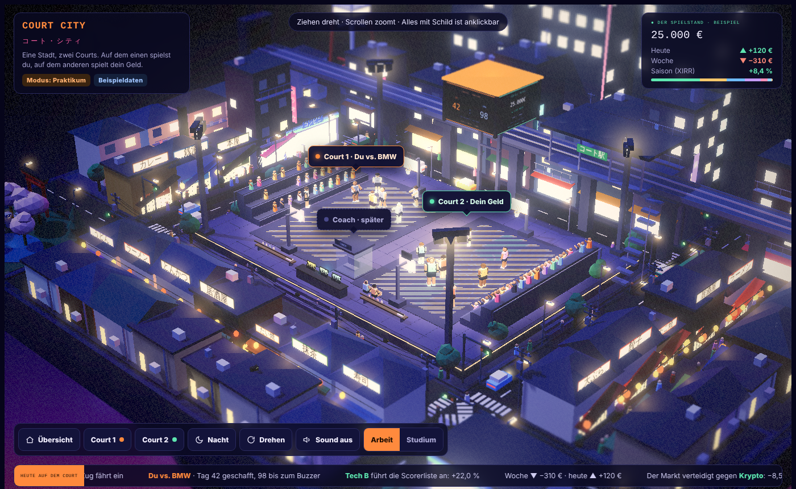

# Court City

*A floating Tokyo-style night city with two basketball courts. On one you play against your employer until your internship ends; on the other your portfolio plays as a team. Pure entertainment, not financial advice. German UI; docs below in German.*



Eine schwebende Stadt im Tokio-Stil, bei Nacht, Low-Poly. In der Mitte zwei hell ausgeleuchtete Basketballplätze:

* **Court 1 · Du.** Du spielst gegen das Team deines Arbeitgebers, bis das Praktikum endet. Der Spielstand zählt Tage. Im Studium wird daraus Wurftraining ohne Gegner.
* **Court 2 · Dein Geld.** Dein Depot als Team. Große Positionen sind große Spieler, Kursgewinne sind Körbe, Dividenden sind Freiwürfe, und in schlechten Wochen klaut der rote Markt den Ball.

Drumherum: Ramen-Läden, Izakayas mit roten Laternen, ein Konbini, eine Hochbahn, ein Schrein mit Kirschblüten, ein Riesenrad, Autos, Passanten, Katzen auf den Dächern. Alles anklickbar, alles mit dezentem Sound. Die ganze Zuordnung steht in [docs/analogy.md](docs/analogy.md).

## Sofort ausprobieren

```bash
git clone https://github.com/tillacs/court-city
cd court-city
npm run dev        # baut dist/ und startet http://localhost:5173
```

Node 18 oder neuer, sonst nichts. Ohne eigene Daten laufen Beispieldaten.

## Eigene Daten

1. `data/portfolio.example.json` nach `data/portfolio.json` kopieren und Zahlen eintragen (die Datei bleibt lokal, sie ist in `.gitignore`).
2. Seite neu laden. Oben links steht dann `portfolio.json` statt `Beispieldaten`.

Court 1 stellst du in der Seite selbst ein: Court anklicken, Gegner, Start und Ende eintragen, speichern.

Weitere Quellen, darunter Parqet live, stehen in [adapters/README.md](adapters/README.md).

## Bedienung

| Aktion | Wie |
|---|---|
| Drehen, Zoomen, Verschieben | Ziehen, Scrollen, rechte Maustaste |
| Details | Court, Spieler oder Schild anklicken |
| Tastatur | `1` / `2` Courts, `R` Auto-Drehen, `Esc` zurück |
| Sound | Knopf unten, standardmäßig aus |
| Tag und Nacht | Knopf unten |

## Mitmachen

Der Code ist bewusst eine Datei ohne Framework, damit man ihn lesen und kopieren kann. Aufbau und Gründe stehen in [docs/architecture.md](docs/architecture.md). Pull Requests willkommen, besonders für den Parqet-Connect-Server und weitere Datenquellen.

MIT-Lizenz.
